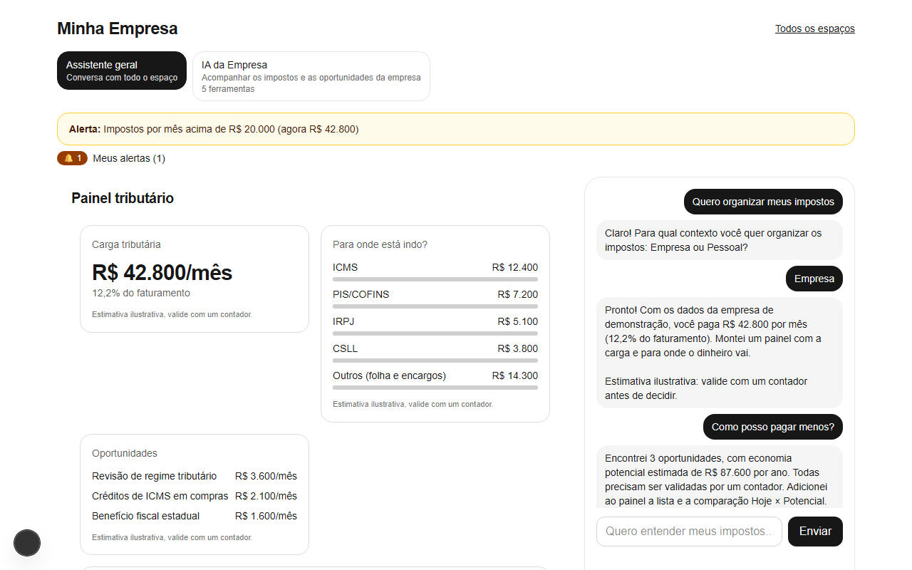
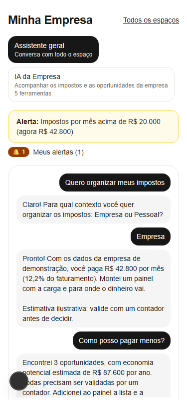
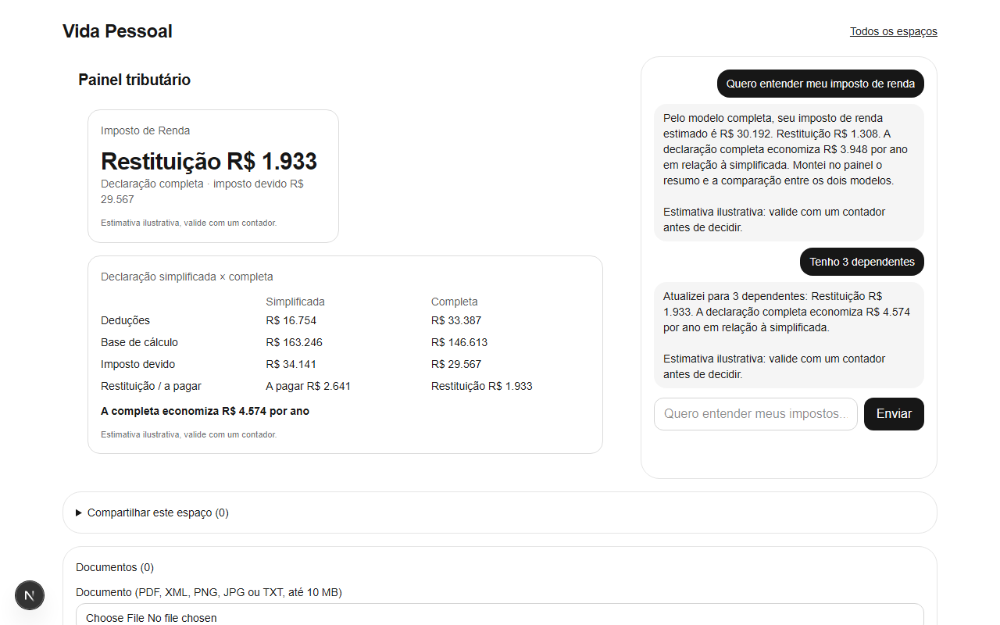
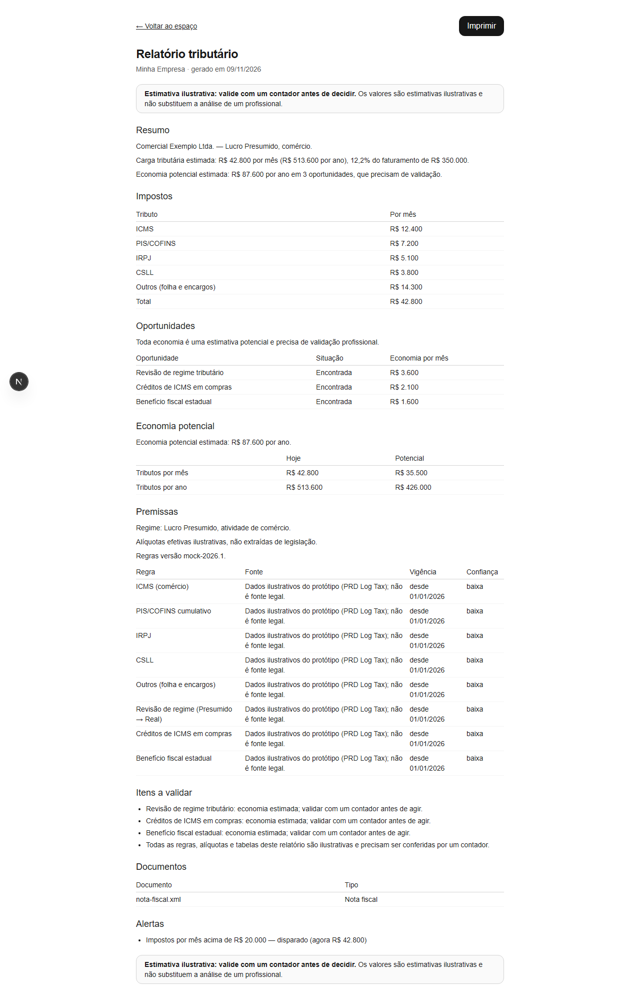
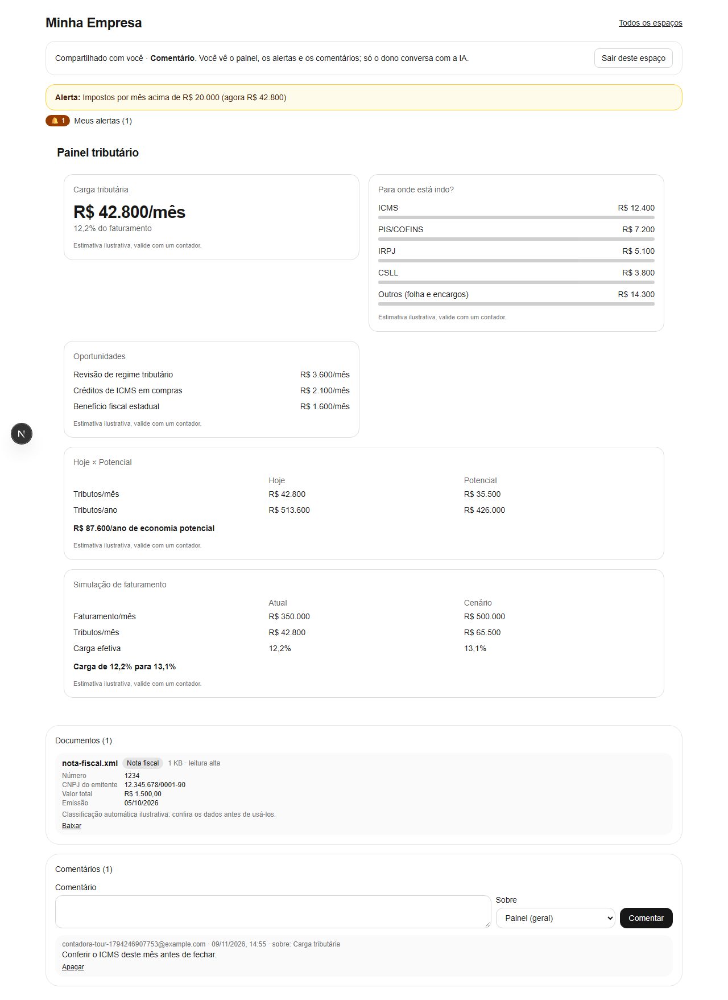
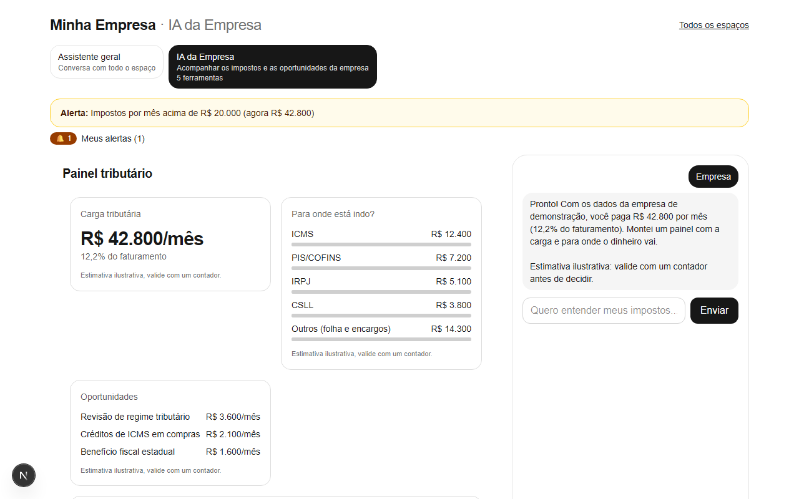
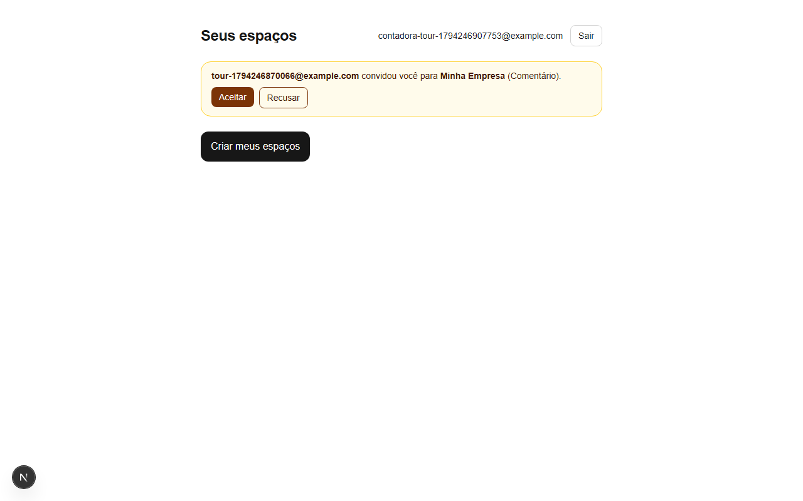

# Log Tax

Assistente de **inteligência tributária conversacional** (pt-BR). Em vez de formulários e menus, a pessoa
conversa com uma IA que calcula, organiza e acompanha os impostos, e a conversa **altera o sistema de verdade**:
cria painéis, alertas, agentes e relatórios. Documento de produto: [`PRD_ecossistema_inteligencia_tributaria_IA.md`](PRD_ecossistema_inteligencia_tributaria_IA.md).
Contrato da versão atual: [`.claude/specs/log-tax-v1/spec.md`](.claude/specs/log-tax-v1/spec.md).

> **Os números são ilustrativos.** O motor tributário é um mock calibrado com os exemplos do PRD e, no Imposto de Renda,
> com a tabela mensal de 2025 anualizada, **sem conferência com a legislação**. Toda tela mostra "estimativa
> ilustrativa, valide com um contador". Não use para decidir nada.



## O que já faz

| | |
|---|---|
| **Empresa** | Diagnóstico (R$ 42,8 mil/mês, 12,2%), para onde vai o dinheiro, oportunidades de economia (R$ 87,6 mil/ano), Hoje × Potencial, simulador de cenários ("e se o faturamento subir para R$ 500 mil?"). |
| **Pessoa física** | Imposto de Renda: declaração simplificada × completa, restituição ou imposto a pagar, recalculado quando a pessoa informa dados novos. |
| **Painel vivo** | 9 tipos de bloco; a IA adiciona, altera, reordena e remove (remover exige a sua confirmação). |
| **Alertas** | "Me avise se meus impostos passarem de R$ 20 mil": avaliados ao abrir e a cada mudança de dado, com faixa e sino no painel. |
| **IAs especializadas** | "Crie uma IA para minha empresa": nome, objetivo e **só as ferramentas** que ela recebeu; conversa própria; o servidor recusa o resto. |
| **Documentos** | Upload (PDF, XML, PNG, JPG, TXT) com consentimento LGPD; NF-e em XML é lida de verdade, PDF/imagem só classificada pelo nome (e o sistema diz isso). Download por URL assinada, e dá para apagar. |
| **Relatório** | Página imprimível (vira PDF) com resumo, impostos, oportunidades, economia, premissas e itens a validar. |
| **Compartilhar** | Convite por email, papéis *leitura* e *comentário*, comentários sobre blocos do painel. A conversa com a IA é só do dono. |

<details>
<summary>Mais telas</summary>

| | |
|---|---|
|  |  |
|  |  |
|  |  |

</details>

## Como rodar

Requisitos: **Node 22+**, **Docker** (para o Supabase local) e, opcionalmente, uma chave da OpenAI.

```sh
npm install
cp .env.example .env.local     # veja "Variáveis de ambiente"
npm run db:start               # Supabase local (Postgres, Auth, Storage, Mailpit) + migrações
npx supabase status -o env     # copie API_URL, ANON_KEY e SERVICE_ROLE_KEY para o .env.local
npm run dev                    # http://localhost:3000
```

1. Abra http://localhost:3000, clique em **Entrar** e peça o link por email.
2. O email chega no **Mailpit**: http://127.0.0.1:55324 (nada sai da sua máquina).
3. Em "Seus espaços" clique em **Criar meus espaços** e abra *Minha Empresa* ou *Vida Pessoal*.
4. Converse. Sem chave da OpenAI, use a IA roteirizada (só em desenvolvimento): `LOG_TAX_LLM=scripted` no `.env.local`.
   Ela responde a frases como *"Quero organizar meus impostos"*, *"Empresa"*, *"Como posso pagar menos?"*, *"E se o faturamento subir para R$ 500 mil?"*, *"Me avise se meus impostos passarem de R$ 20 mil"*, *"Crie uma IA para minha empresa"* e *"Gere um relatório"*.

Portas do Supabase local: 55321 (API), 55322 (Postgres), 55324 (Mailpit). Para recomeçar do zero: `npm run db:reset`.

### Variáveis de ambiente (`.env.local`)

| Variável | Para quê |
|---|---|
| `NEXT_PUBLIC_SUPABASE_URL`, `NEXT_PUBLIC_SUPABASE_ANON_KEY` | Cliente do Supabase (saem de `npx supabase status -o env`). |
| `SUPABASE_SERVICE_ROLE_KEY` | Só para os testes de integração; **nunca** no navegador. |
| `OPENAI_API_KEY`, `OPENAI_MODEL` | IA real (Responses API com `store:false`: nada fica retido na OpenAI). Há um modelo padrão em `src/chat/openai-llm.ts`. |
| `LOG_TAX_LLM=scripted` | IA roteirizada por palavras-chave, **bloqueada em produção**. |
| `SUPABASE_AUTH_GOOGLE_CLIENT_ID`, `SUPABASE_AUTH_GOOGLE_SECRET` | Login com Google, em `supabase/.env` (opcional). Redirect do Google: `http://127.0.0.1:55321/auth/v1/callback`. |

> Uma variável `OPENAI_API_KEY` já definida no sistema tem prioridade sobre o `.env.local`.

## Testes

Cada camada prova uma coisa diferente. Todas passam no mesmo gate do CI e do pre-commit (`npm run check`).

| Comando | O que roda | Precisa de |
|---|---|---|
| `npm run check` | lint + typecheck + testes unitários (motor, painel, ferramentas, orquestrador, relatório, documentos…) | nada |
| `npm run test:rls` | **banco real**: isolamento entre usuários, papéis, Storage, jornada pelo chat | `db:start` |
| `npm run e2e` | **navegador real** (Playwright): jornadas, compartilhamento em dois navegadores, upload, PDF do relatório, **acessibilidade WCAG 2.2 AA (axe) e layout de celular** em todas as telas | `db:start` |
| `npm run test:live` | o loop de ferramentas com o **modelo real** da OpenAI (custa tokens) | `OPENAI_API_KEY` |
| `E2E_REAL_LLM=1 npx playwright test real-llm` | navegador → `/api/chat` → OpenAI → banco | idem |
| `E2E_TOUR=1 npx playwright test tour --workers=1` | rode **sozinho**; refaz as capturas de `docs/screenshots` percorrendo o produto inteiro | `db:start` |

O CI roda `check` e `test:rls` (o Supabase sobe no próprio job). Commits passam pelo `pre-commit` (`pip install pre-commit && pre-commit install`).

## Como funciona

```
navegador ── /api/chat ──► handleChat ──► orquestrador (loop de ferramentas) ──► IA (OpenAI | roteirizada)
                │                │                    │
                │                │                    └─► 15 ferramentas, validadas por Zod e escopadas
                │                │                         (por espaço, por agente, confirmação fora de banda)
                │                └─► carrega/salva o estado do espaço (Supabase, sob RLS)
                └─► páginas (Next.js 15, App Router) ──► painel, relatório, documentos, comentários

Motor tributário (TaxEngine, mock) ◄── a IA **não calcula**: chama o motor e explica o resultado
```

- **A IA nunca inventa número:** cálculo vem do `TaxEngine`; dado que falta vira pergunta ou "faltam dados".
- **Quem manda é o banco:** toda escrita passa pela sessão do usuário, e a RLS decide (dono escreve; leitor e comentarista só leem/comentam; conversa com a IA é só do dono; Storage escopado por espaço).
- **Painel = JSON de blocos** versionado; a IA só edita esse JSON por ferramentas, nunca gera código.
- Estrutura: `src/engine` (motor), `src/chat` (IA, ferramentas, estado), `src/dashboard`, `src/alerts`, `src/documents`, `src/report`, `src/sharing`, `supabase/migrations` (schema e políticas), `e2e` (Playwright).

## Limites conhecidos

- Motor tributário **mock**: só Lucro Presumido (empresa) e uma tabela de IRPF ilustrativa; sem integração com Receita, SEFAZ ou ERPs.
- PDF e imagem não são lidos (sem OCR); NF-e em XML é lida.
- Respostas do chat chegam inteiras (sem streaming); o histórico completo é reenviado a cada turno.
- O convite de compartilhamento **não envia email** (a pessoa vê o convite ao entrar com aquele email); em produção falta configurar SMTP.
- Interface apenas em tema claro e em pt-BR; sem voz, app nativo, inventário ou patrimônio.
- `npm run dev` compila cada rota na primeira visita: no e2e, as primeiras ações são lentas.
