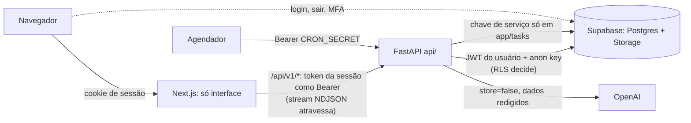

# Backend em FastAPI: arquitetura, decisões, variáveis, deploy e revisão de segurança (#316)

Épico #287. **Estado (2026-11-20):** todo o código de backend existe em `api/` (motor, chat, documentos, jobs, relatório, exportação,
exclusão de conta, compartilhamento, consentimentos, espaços). O Next.js **ainda** acessa o banco por conta própria nas telas e nas
server actions; o corte final (#314) e a hospedagem (#291) estão pendentes. Onde o texto diz `[após #291]`, depende dessa decisão.

## 1. Diagrama

- O navegador nunca fala com o FastAPI diretamente: o proxy `src/lib/api-proxy.ts` (mesma origem, sem CORS) põe o token do usuário
  e repassa só os cabeçalhos necessários (`content-type`, `accept`, `x-request-id`, IP) e devolve só os cabeçalhos seguros (inclui
  `Location` do download assinado).
- Autenticação (login, sair, sessões, MFA) continua no Supabase Auth, no front. O FastAPI só **valida** o JWT.

## 2. Decisões (ADR resumido)

| # | Decisão | Por quê | Consequência |
|---|---|---|---|
| 1 | Todo o backend em FastAPI, no mesmo repositório (`api/`) | Um motor tributário, uma regra de acesso, tipos gerados do contrato | CI com job próprio (`api`, `api-rls`) |
| 2 | O motor TS foi portado e provado por 1.180+ casos dourados antes de remover o TS | Paridade verificável, divergências documentadas (ex.: artefato de ponto flutuante do TS) | `api/tests/golden/cases.json` é regerado por `golden-export.test.ts` a cada mudança de regra no TS |
| 3 | Acesso a dados **com a sessão do usuário** (JWT repassado ao PostgREST/Storage) | O RLS continua sendo a barreira; nenhuma rota usa chave de serviço para dado de usuário | Rotas ficam finas; recusa vira 403/404 sem detalhe |
| 4 | Chave de serviço isolada em `app/tasks` (cron e exclusão de conta) | Só duas operações precisam burlar o RLS | `import-linter` proíbe qualquer outro pacote de importar `app.tasks.system`; as duas portas HTTP são exceções nomeadas |
| 5 | Regras tributárias como dados com vigência, fonte e confiança (`rules.json`) | Auditável e atualizável sem mexer em código | Selo do resultado e "regras vencidas" no log |
| 6 | Dinheiro em `Decimal` (JSON como string decimal exata) e centavos inteiros no cálculo | Sem `float` em valor monetário | O front formata; o contrato tem o formato |
| 7 | Chat: orquestrador com limite de passos, cancelamento, redação de dados e conteúdo externo marcado como não confiável | Segurança contra injeção de instruções | Ferramenta que escreve exige aprovação do usuário depois de documento/comentário |
| 8 | Sem SDK da OpenAI: `httpx` direto na Responses API (`store=false`) | Uma dependência a menos, controle de timeout/tentativas/cancelamento | Cliente em `app/chat/openai_llm.py` |
| 9 | Uploads: `python-multipart`; NF-e lida com `defusedxml` | O parser padrão do Python expande entidades | DTD/entidades externas recusados (teste XXE e bomba de expansão) |
| 10 | Flag por ambiente para o chat (`NEXT_PUBLIC_CHAT_API=fastapi`) | Poder voltar atrás na hora | Padrão continua na rota Next.js |

## 3. Variáveis e segredos por ambiente

Segredos **nunca** no repositório; `.env.example` lista os nomes. FastAPI lê `LOGTAX_*` (prefixo) e as variáveis legadas abaixo.

| Variável | Onde | Segredo? | Observação |
|---|---|---|---|
| `LOGTAX_SUPABASE_URL` | API | não | URL do projeto; também é o emissor (`iss`) do JWT |
| `LOGTAX_SUPABASE_ANON_KEY` | API | não (pública) | Identifica o projeto no Data API; quem concede acesso é o JWT |
| `LOGTAX_SUPABASE_JWT_SECRET` | API | **sim** | Só para projetos HS256 (Supabase local). Em projetos assimétricos o JWKS é usado |
| `LOGTAX_SUPABASE_SERVICE_ROLE_KEY` | API | **sim** | Só `app/tasks` (cron, exclusão de conta). Nunca no front |
| `OPENAI_API_KEY`, `OPENAI_MODEL` | API | **sim** (chave) | Sem a chave o chat responde 503 |
| `DATA_ENCRYPTION_KEY`, `DATA_ENCRYPTION_KEY_ID` (+ `DATA_ENCRYPTION_KEY_<ID>` antigas) | API e Next | **sim** | 32 bytes em base64. Em produção a API recusa cifrar/abrir sem a chave |
| `CRON_SECRET` | API e agendador | **sim** | Sem ele, `/v1/cron/run` responde 401 a todos |
| `CHAT_DAILY_TOKENS`, `DOCUMENT_QUOTA_BYTES`, `VIRUS_SCAN_URL` | API | não | Limites e scanner opcional |
| `LOGTAX_ENVIRONMENT` | API | não | `production` desliga `/docs`, recusa o modelo `scripted` e exige a chave de cifra |
| `LOGTAX_CORS_ORIGINS` | API | não | Lista de origens do app; vazio = nenhuma (o proxy é de mesma origem) |
| `API_URL` | Next | não | Onde o proxy encontra a API |
| `NEXT_PUBLIC_CHAT_API` | Next (build) | não | `fastapi` liga o chat Python |
| `LOG_TAX_LLM=scripted`, `LOG_TAX_DEMO_SEED=1` | só dev/e2e | não | `scripted` é **recusado** em produção |

## 4. Runbook de deploy e rollback `[após #291]`

Onde rodar (função Python na mesma plataforma ou contêiner), região, tempo máximo de requisição (o chat pode levar dezenas de
segundos; o upload aceita até 10 MB, o corpo máximo é 11 MB só em `POST /v1/documents` e 1 MB nas demais) e custo são decisões do
dono (#291). Receita independente da plataforma:

1. **Antes do merge:** CI verde (`check`, `build`, `api`, `api-rls`, `rls`, `e2e`, CodeQL, segredos). Mudança de contrato sem
   `api/openapi.json` e `src/api/schema.d.ts` atualizados falha o CI.
2. **Publicar a API primeiro**, com a flag do chat **desligada**. Conferir `GET /health` (200), `GET /v1/me` com um token de teste e
   `GET /v1/cron/run` sem segredo (401).
3. Apontar `API_URL` do Next para a API e ligar `NEXT_PUBLIC_CHAT_API=fastapi` **no preview** primeiro; fazer uma conversa de empresa
   e uma de pessoa física; conferir os logs (só métricas) e a trilha de atividade.
4. Migrar o tráfego rota a rota (chat → documentos → compartilhamento → …), uma de cada vez, observando erros e latência.
5. Trocar o agendador (`vercel.json` ainda chama `/api/cron/run`) para `GET {API}/v1/cron/run` com `Authorization: Bearer $CRON_SECRET`.

**Rollback:** desligar a flag (`NEXT_PUBLIC_CHAT_API` vazio) e redeploy do Next devolve o chat ao TypeScript em segundos; o estado
é o mesmo banco e o mesmo formato (o perfil do espaço, o painel e a conversa são gravados igual pelos dois lados). A API pode ser
revertida por promoção do deploy anterior; migrações de banco continuam aditivas (ver `docs/runbook.md`).

## 5. Revisão de ameaças

| Ameaça | Controle | Onde está provado |
|---|---|---|
| Token forjado ou de outro projeto | Algoritmo escolhido pelo servidor (HS256 com segredo ou RS/ES256 com JWKS), `exp`, `sub`, `aud`, `iss` obrigatórios; `none` recusado | `tests/test_auth.py` |
| Acesso a dado de outra pessoa | Toda rota usa a sessão do usuário; RLS no banco; recusa sem detalhe | `tests/integration/*` (chat, documentos, compartilhamento, exclusão) |
| Chave de serviço vazar para rota de usuário | Isolada em `app.tasks.system`; contrato do `import-linter`; só cron e exclusão de conta a alcançam | `lint-imports` no CI, `tests/test_system_isolation.py` |
| Cron aberto | `CRON_SECRET` com comparação em tempo constante; sem segredo configurado, 401 a todos; JWT de usuário não vale | `tests/test_jobs.py` |
| Injeção de instruções por documento/comentário | Texto externo embrulhado em `<dados_externos>` (tag forjada neutralizada, inclusive com espaços); depois dele, ferramenta que escreve exige aprovação do usuário; destrutiva sempre exige | `tests/test_chat_core.py`, `tests/test_chat_tools.py` |
| Dados pessoais indo para a OpenAI | `redact()` em instruções, mensagens e resultados de ferramenta (CPF, CNPJ, chave NF-e, conta); `store=false` | `tests/test_llm.py` |
| Arquivo malicioso | Tipo real pelo conteúdo, EICAR/scanner, cota, 10 MB; XML sem DTD/entidades (`defusedxml`) | `tests/test_documents.py` |
| Abuso de uso e de custo | Limite por usuário e por IP (banco), orçamento diário de tokens, passos máximos por turno | `tests/test_chat_api.py` |
| Logs com dado pessoal | Só métricas (rota, usuário opaco, latência, ferramentas, tokens); o corpo, a mensagem e a resposta nunca; falhas só com o tipo do erro | `tests/test_chat_api.py` (log sem o texto) |
| CNPJ em repouso | AES-256-GCM com id de chave e rotação; mesmo formato do TS | `tests/test_chat_state.py` |
| CORS | Origens explícitas (vazio = nenhuma); o proxy de mesma origem dispensa CORS; métodos e cabeçalhos limitados | `app/main.py` |
| Cabeçalhos | `nosniff`, `DENY`, `no-store`, `Referrer-Policy` em toda resposta da API | `app/core/middleware.py` |
| Exclusão de conta | E-mail digitado, arquivos antes do usuário, falha no Storage interrompe, trilha `account_deleted` | `tests/test_report_account.py`, `tests/integration/test_account.py` |

### Pendências conhecidas (decisão humana)

1. **Hospedagem, região, custo e plataforma** (#291), e o ambiente de preview onde o runbook acima seja ensaiado.
2. **Tabelas do IRPF de 2026** (#98/#93): com o motor real o espaço pessoal recusa calcular (o motor TS do chat dava um valor
   ilustrativo). A flag do chat não deve ir a produção antes de conferir essas tabelas.
3. **Corte do front** (#314): trocar as server actions e as leituras do Next por chamadas à API, remover `src/engine`,
   `src/chat`, `src/jobs` e as rotas `/api/*` de dados, e o teste de varredura "nenhum acesso do Next ao banco além da autenticação".
   Faltam endpoints de **leitura** para as telas (lista e estado do espaço, membros, convites, atividade, documentos, privacidade,
   admin), que as issues D1–D5 não cobriam.
4. Revisão humana desta tabela e do runbook em preview.
